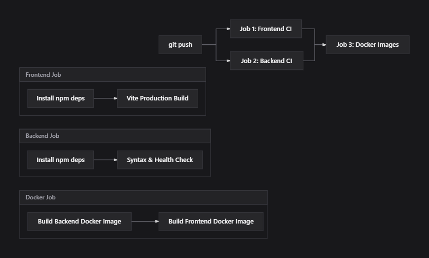

# ShopSphere — Self-Healing E-Commerce Platform & Cloud-Native Infrastructure

[](https://github.com)
[](https://www.docker.com/)
[](https://kubernetes.io/)
[](https://nodejs.org/)
[](https://react.dev/)
[](https://tailwindcss.com/)

**ShopSphere** is a high-availability, production-style e-commerce web application engineered with a modern monochrome glassmorphism frontend, an Express REST API backend, Docker multi-stage containerization, a 3-replica **Kubernetes self-healing infrastructure** with automated health probes, and an automated **GitHub Actions CI/CD pipeline**.

---

## 📑 Table of Contents

- [Project Overview & Objectives](#-project-overview--objectives)
- [System Architecture](#-system-architecture)
- [Key Features](#-key-features)
- [Technology Stack](#-technology-stack)
- [Folder Structure](#-folder-structure)
- [Local Setup (Development)](#-local-setup-development)
- [Docker Containerization](#-docker-containerization)
- [Kubernetes Deployment (Minikube)](#-kubernetes-deployment-minikube)
- [Self-Healing Demonstration](#-self-healing-demonstration)
- [CI/CD Pipeline (GitHub Actions)](#-cicd-pipeline-github-actions)
- [Essential Commands Cheatsheet](#-essential-commands-cheatsheet)

---

## 🎯 Project Overview & Objectives

In production environments, infrastructure failures (crashed pods, memory spikes, unexpected process exits) must be isolated and resolved automatically without downtime or degraded end-user experience. 

The primary objectives of this project are:
1. **Realistic Commercial Experience**: Provide an e-commerce storefront with high visual standards (monochrome luxury design with frosted glassmorphism), full product filtering, real-time search, cart state management, and simulated checkout.
2. **Autonomous Self-Healing**: Deploy the backend service across **3 replicas** behind a Kubernetes `ClusterIP` load balancer with automated `livenessProbe` and `readinessProbe` monitoring.
3. **Container-Native Architecture**: Decouple frontend and backend into independently deployable, resource-bounded Docker images with Nginx reverse-proxying.
4. **CI/CD Quality Gate**: Maintain an automated GitHub Actions pipeline validating frontend builds, backend health checks, and container image generation on every push.

---

## 🏛️ System Architecture

```
[ Client Browser ]
        │ (Port 8080)
        ▼
┌────────────────────────────────────────────────────────┐
│ Kubernetes Node / Minikube                             │
│                                                        │
│  [ Service: frontend (NodePort 30080 -> 80) ]          │
│                          │                             │
│                          ▼                             │
│           ┌─────────────────────────────┐              │
│           │ Pod: shopsphere-frontend    │              │
│           │ (Nginx: Alpine + React SPA) │              │
│           └──────────────┬──────────────┘              │
│                          │ /api/ reverse proxy         │
│                          ▼                             │
│           [ Service: backend (ClusterIP :5000) ]       │
│             (Round-robin load balancing)               │
│               ┌──────────┼──────────┐                  │
│               │          │          │                  │
│               ▼          ▼          ▼                  │
│          ┌─────────┐┌─────────┐┌─────────┐             │
│          │ Replica ││ Replica ││ Replica │             │
│          │ Pod 1   ││ Pod 2   ││ Pod 3   │             │
│          │ (:5000) ││ (:5000) ││ (:5000) │             │
│          └─────────┘└─────────┘└─────────┘             │
│               ▲          ▲          ▲                  │
│               └──────────┴──────────┘                  │
│             Automated Liveness/Readiness               │
│             HTTP GET /api/health Probes                │
└────────────────────────────────────────────────────────┘
```

- **Frontend Tier**: Nginx serves the compiled static React SPA and acts as an internal API Gateway proxying `/api/*` calls to `http://backend:5000/api/*`.
- **Backend Tier**: Express REST API running across 3 pods in a Kubernetes Deployment. Each pod reports its unique pod name (`HOSTNAME`), memory consumption, and uptime.
- **Service Discovery**: Kubernetes CoreDNS resolves `backend:5000` to the internal ClusterIP service, transparently load-balancing traffic across all ready replica pods.

---

## ✨ Key Features

1. **Storefront & Discovery**:
   - Announcement bar with discount voucher code support (`SPHERE10`).
   - Dynamic Hero Banner, featured category spotlights, and responsive layout.
   - Live cluster pod indicator pill showing real-time backend pod hostname routing.
2. **Product Catalog & Search**:
   - 33 curated luxury products across 5 categories (`audio`, `electronics`, `home`, `accessories`, `fashion`).
   - Multi-faceted sidebar filtering: category selection, dynamic price slider ($50 – $650), rating filter, and in-stock toggles.
   - Instant search dropdown with keyword highlighting and no-results states.
3. **Cart & Demo Checkout**:
   - Cart synchronization backed by LocalStorage.
   - Dynamic free shipping calculation threshold with progress bar.
   - Multi-step simulated checkout (address validation, payment selector: Card, UPI, Net Banking, COD) returning a confirmed order ID (`ORD-XXXXXX`) and tracking number.
4. **Resilience & Self-Healing**:
   - Dedicated health endpoint (`/api/health`) and liveness endpoint (`/healthz`).
   - Auto-restarts failing pods; automatically provisions replacement pods if a pod is terminated.

---

## 🛠️ Technology Stack

| Layer | Technologies |
| :--- | :--- |
| **Frontend** | React 18, Vite 5, Tailwind CSS 3, React Router v6, Lucide React |
| **Backend** | Node.js 20 LTS, Express.js 4, CORS |
| **Web Server / Proxy** | Nginx Alpine (Gzip compression, SPA routing fallback, API proxy) |
| **Containerization** | Docker, Docker Compose, Multi-stage Docker builds |
| **Orchestration** | Kubernetes v1.32+ (Minikube), RollingUpdate Deployments, Services |
| **CI/CD** | GitHub Actions (multi-job matrix for frontend, backend, and Docker) |

---

## 📁 Folder Structure

```
Self Healing Infrastructure System/
├── .github/
│   └── workflows/
│       └── ci.yml               # GitHub Actions CI/CD definition
├── backend/
│   ├── data/
│   │   ├── categories.js        # Catalog category definitions
│   │   └── products.js          # 33 curated product records with specs
│   ├── routes/
│   │   ├── healthRoutes.js      # /api/health and /healthz endpoints
│   │   ├── orderRoutes.js       # Demo order submission & validation
│   │   └── productRoutes.js     # Filter, sort, search, & pagination API
│   ├── .dockerignore
│   ├── Dockerfile               # Node 20 production container
│   ├── package.json
│   └── server.js                # Express server entry point
├── docs/
│   └── images/
│       └── cicd-pipeline.png    # CI/CD workflow flowchart
├── frontend/
│   ├── src/
│   │   ├── components/          # Reusable UI & layout modules
│   │   ├── context/             # Cart, Toast, and Wishlist contexts
│   │   ├── pages/               # Home, Products, Details, Cart, Checkout
│   │   ├── services/            # API integration layer
│   │   └── App.jsx
│   ├── .dockerignore
│   ├── Dockerfile               # Multi-stage build (Node build -> Nginx)
│   ├── nginx.conf               # Nginx reverse proxy & SPA fallback
│   ├── package.json
│   └── vite.config.js
├── k8s/
│   ├── backend-deployment.yaml  # 3 replicas, liveness & readiness probes
│   ├── backend-service.yaml     # Internal ClusterIP service on port 5000
│   ├── frontend-deployment.yaml # Nginx frontend pod deployment
│   └── frontend-service.yaml    # NodePort service on port 30080
├── .gitignore
├── docker-compose.yml           # Local multi-container Docker compose
└── README.md
```

---

## 💻 Local Setup (Development)

### Prerequisites
- Node.js 20+ installed
- Git installed

### 1. Run Backend
```bash
cd backend
npm install
npm start
# Server runs on http://localhost:5000
# Health check: http://localhost:5000/api/health
```

### 2. Run Frontend
```bash
cd frontend
npm install
npm run dev
# Vite runs on http://localhost:5173
```

---

## 🐳 Docker Containerization

Both services are containerized with optimized, security-focused images.

### Start with Docker Compose
```bash
docker compose up -d --build
```

### Verify Running Containers
```bash
docker compose ps
```

| Service | Container Name | Status | Port Mapping |
| :--- | :--- | :--- | :--- |
| **Backend** | `shopsphere-backend` | Up (healthy) | `0.0.0.0:5000->5000` |
| **Frontend** | `shopsphere-frontend` | Up (healthy) | `0.0.0.0:8080->80` |

- **Website**: [http://localhost:8080](http://localhost:8080)
- **API Health**: [http://localhost:8080/api/health](http://localhost:8080/api/health)

### Stop Docker Compose
```bash
docker compose down
```

---

## ☸️ Kubernetes Deployment (Minikube)

The production configuration runs the application on Kubernetes with **3 backend replicas** and automated health monitoring.

### 1. Start Minikube & Load Images
```bash
# Start Minikube with Docker driver
minikube start --driver=docker

# Build or load images into Minikube
minikube image load shopsphere-backend:1.0.0
minikube image load shopsphere-frontend:1.0.0
```

### 2. Apply Manifests
```bash
kubectl apply -f k8s/
```

### 3. Verify Deployments & Pods
```bash
kubectl get deployments
kubectl get pods -o wide
kubectl get svc
```

Sample output:
```text
NAME                                   READY   STATUS    RESTARTS   IP            NODE
shopsphere-backend-545cb97f88-4g7l5    1/1     Running   0          10.244.0.11   minikube
shopsphere-backend-545cb97f88-cp4sn    1/1     Running   0          10.244.0.16   minikube
shopsphere-backend-545cb97f88-nx755    1/1     Running   0          10.244.0.10   minikube
shopsphere-frontend-7dd7bbf55f-9c2r5   1/1     Running   0          10.244.0.15   minikube
```

### 4. Health Probes Configuration
Defined in [`k8s/backend-deployment.yaml`](file:///c:/Private/Hands-On/Self%20Healing%20Infrastructure%20System/k8s/backend-deployment.yaml):
- **Readiness Probe**: Queries `/api/health:5000` with `initialDelaySeconds: 5`, `periodSeconds: 5`. Traffic is only routed to the pod once this probe returns HTTP 200.
- **Liveness Probe**: Queries `/api/health:5000` with `initialDelaySeconds: 15`, `periodSeconds: 10`, `failureThreshold: 3`. If the endpoint fails 3 consecutive times, kubelet restarts the container.
- **Resource Constraints**:
  - Backend: Requests `50m CPU / 64Mi RAM`, Limits `250m CPU / 256Mi RAM`.
  - Frontend: Requests `25m CPU / 32Mi RAM`, Limits `150m CPU / 128Mi RAM`.

### 5. Access the Storefront
```bash
kubectl port-forward svc/frontend 8080:80
```
Open [http://localhost:8080](http://localhost:8080) in your browser.

---

## 🔄 Self-Healing Demonstration

The Kubernetes ReplicaSet controller continually reconciles desired state (3 backend pods) against actual cluster state.

### Step-by-Step Chaos Test

1. **Watch pods in terminal A**:
   ```bash
   kubectl get pods -l app=shopsphere-backend -w
   ```

2. **Simulate pod failure in terminal B** by deleting an active pod:
   ```bash
   kubectl delete pod <pod-name-from-terminal-a>
   ```

3. **Observe Self-Healing Recovery**:
   - The targeted pod immediately transitions to `Terminating`.
   - The ReplicaSet controller instantly detects that only 2 replicas remain active.
   - A replacement pod is provisioned and transitioned to `ContainerCreating` -> `Running` within seconds.
   - **Zero Downtime**: Active HTTP requests made to `http://localhost:8080/api/health` continue returning HTTP 200 via the remaining healthy replicas without user-visible errors.

---

## 🚀 CI/CD Pipeline (GitHub Actions)

An automated continuous integration workflow is configured at [`.github/workflows/ci.yml`](file:///c:/Private/Hands-On/Self%20Healing%20Infrastructure%20System/.github/workflows/ci.yml). It validates every commit and pull request on Ubuntu runners without requiring paid cloud infrastructure or secrets.



### Pipeline Stages
1. **Frontend Job**:
   - Installs frontend dependencies with npm caching.
   - Builds production React assets using Vite (`npm run build`).
2. **Backend Job**:
   - Installs backend dependencies.
   - Runs syntax integrity checks (`npm test`).
3. **Docker Build Job**:
   - Runs once frontend and backend jobs pass.
   - Builds both `shopsphere-backend` and `shopsphere-frontend` Docker images to guarantee deployment readiness.

### Pushing Code to GitHub
```bash
git remote add origin https://github.com/<YOUR_USERNAME>/<YOUR_REPOSITORY>.git
git branch -M main
git push -u origin main
```
Track live progress under the **Actions** tab in your GitHub repository.

---

## ⚡ Essential Commands Cheatsheet

| Task | Command |
| :--- | :--- |
| **Start Docker Compose** | `docker compose up -d --build` |
| **Check Docker Containers** | `docker compose ps` |
| **View Docker Logs** | `docker compose logs -f` |
| **Stop Docker Compose** | `docker compose down` |
| **Start Minikube** | `minikube start --driver=docker` |
| **Apply K8s Manifests** | `kubectl apply -f k8s/` |
| **List Pods & IPs** | `kubectl get pods -o wide` |
| **Watch Pod Status** | `kubectl get pods -w` |
| **Inspect Pod Details** | `kubectl describe pod <pod-name>` |
| **Stream Backend Logs** | `kubectl logs -l app=shopsphere-backend -f` |
| **Port Forward Frontend** | `kubectl port-forward svc/frontend 8080:80` |
| **Simulate Pod Failure** | `kubectl delete pod <backend-pod-name>` |

---

## 📄 License
This project is open-source and available under the [MIT License](LICENSE).
